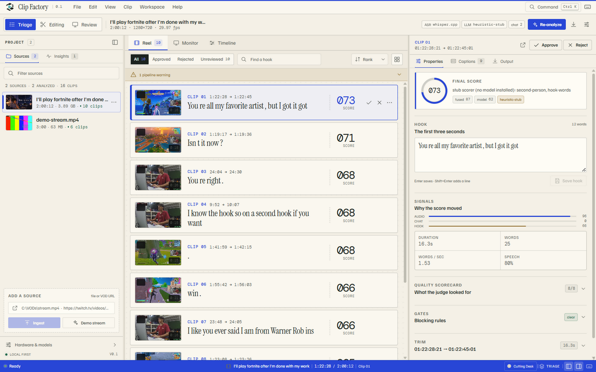

# Clip Factory

Local-first stream clipper. Point it at a long VOD; it finds the moments worth
posting and hands you a reviewable reel with a quality scorecard on every clip.
Nothing leaves the machine on its own: URL imports, uploads, account syncs and
model downloads each wait for you to press the button, and the only model is the
one you install.

Built for laptops that are not fast: the deterministic signals do the finding,
the LLM only re-ranks a short list, and the whole analysis pipeline peaks under
90 MB of resident memory for a 3-minute source (see [Measured cost](#measured-cost),
reproduced by `scripts/perf.py`).



Navigation is three areas in the left rail: **Library** for sources and ingest,
**Clips** for the reel, monitor, timeline and inspector, and **Publish** for
uploads, accounts and performance. Each area owns one header, so the source
picker, the analyze action and the Clips / Monitor / Timeline switch live with
the reel instead of in a second toolbar across the app.

The Library manages sources in place: **Relink** follows a moved file without
re-analyzing it, and **Remove** deletes a media file only when the app downloaded
it into its own folder, never an original you imported.

The workspace ships with six themes and a Studio for making your own. Every panel,
hairline and monitor tone comes from nine seeds; see [theme authoring](docs/theme-authoring.md)
for the file format and a starter theme. The full manual starts at the
[wiki](docs/wiki/Home.md).

## Your first five minutes

Install, open the app, and follow the seven-step tour: it sets up the machine,
then makes one real clip with you. The demo video needs no models, so the tour
works on a fresh install.

1. **One long video in.** Drop a file, paste a link, or press **Demo stream**.
2. **Is this computer ready?** Three checks: video tools, reading speech, judging
   clips. Two usually pass. Nothing blocks you.
3. **Let it watch.** Press **Analyze**; the status bar says Listening, Reading
   speech, Finding moments, Scoring, Picking clips.
4. **Read what it found.** Each card shows the hook, what it noticed, and the score.
5. **You get the last word.** Approve or reject. Rejections teach the ranking.
6. **Make the file.** Render writes a vertical MP4 with burned-in captions.

Stop and resume any time; progress is saved. The tour is also under
**Help → Take the tour**, and the written version is
[Your First Clip](docs/wiki/Your-First-Clip.md). Setup again is
**Help → This computer**, where the optional model runner address also lives.

---

## What actually works right now

| Area | State |
|---|---|
| Ingest: local file or VOD URL (yt-dlp), ffprobe, streamed audio, peak pyramid | working |
| Transcription: whisper.cpp adapter + SRT/VTT import + deterministic stub | working |
| Languages: per-ingest language picker, multilingual Whisper models, script-aware captions and fonts, translate-to-English | working |
| Word alignment (monotonic clamp, silence snapping, outlier repair) | working |
| Signals, percentile fusion, sentence-aligned windows | working |
| Chat replay: Twitch VOD fetch, coverage report, chat signal | working |
| Quality gates + visible scorecard + reel quality score | working |
| LLM re-ranking with GBNF-constrained JSON, plus a labelled stub scorer | working |
| Diversity/overlap/dedupe selection | working |
| Caption page grouping with CPS + line-budget warnings, script-aware line breaking | working |
| Subtitle studio: per-clip preset and overrides, apply to all, reset | working |
| Scene-cut detection, window snapping, shot boundaries | working |
| Auto reframe: per-shot 9:16 crop from motion + skin; optional face model installable in Models | working |
| Trim in/out with transcript, captions and gates kept in sync | working |
| Feedback loop: decision log → taste re-ranker → few-shot memory → style profile | working |
| Connected accounts: YouTube/X OAuth, OS credential store, post + engagement sync | working |
| Weekly learning: engagement-rate labels, gated personal model, promote/rollback | working |
| Coach: evidence-backed clip suggestions with preview, apply and undo | working |
| Hardware probe + tier advisory + model recommendations | working |
| Model manager: resumable downloads in-app (multilingual speech, scoring, face tracking), activation that survives restart | working |
| Desktop shell (Electron + Python sidecar, orphan-proof) | working |
| Windows installer (NSIS, per-user, bundled Python runtime; unsigned) | working |
| ASS/libass caption burn + vertical 1080x1920 render via ffmpeg | working |
| Hardware encoder probing (AMF/NVENC used only when a test encode passes) | working |
| Editor handoff: OTIO, FCP7 XML, FCP X XML, CMX 3600 EDL, SRT/VTT, bake-to-MP4s, zip bundle | working |
| Publishing: YouTube/X upload with your own OAuth client, durable queue, retry, cancel | working |
| Gold-set pick-quality harness + CI regression gate (shipped demo) | working |
| MIT license | working (see [LICENSE](LICENSE)) |
| Code signing, bundled ffmpeg/whisper, auto-update, real-VOD gold sets | **not yet built** |

The reel now leaves the app: one zip carries an OTIO timeline, an FCP7 XML, an
EDL, per-clip SRT captions and a manifest, all with timecodes from the same
functions. What is *not* built is driving `filmcraft-cli` directly, because that
alpha project has not published its command schema — inventing one would be a
handoff that fails on the user's machine. OTIO is its documented import path, so
that is the path this uses.

---

## How a clip actually gets made

Every clipper advertises "AI finds your best moments". Here is what that has to
mean mechanically, and what this build does at each step.

**1. Look for cheap evidence first.** Loudness, spectral flux, speech density,
and a hook lexicon cost nothing and are right often enough to cut 99% of the
timeline. A 3B model reading 6,000 words to find five clips is how you get
confident, well-formatted, mediocre picks.

**2. Cut on sentences, not a grid.** Windows are built from utterance
boundaries, so "starts and ends mid-sentence" is impossible by construction
rather than filtered out afterwards. A 30 s target with 15–90 s clamps covers
the shape of a short.

**3. Move the edges onto real edits.** A clip that opens two frames before a
scene change reads as a mistake. Cuts are detected (**keyframes only** — a
streaming VOD has a 2 s GOP, so this is thousands of decodes instead of
hundreds of thousands) and edges within 0.75 s are snapped onto them. The
transcript is then rebuilt from the utterances the new span covers, which is what
keeps captions and gates from silently disagreeing with the timecode.

**4. Reject before spending tokens.** Gates run on every window first: ASR
confidence, speech coverage, hallucination shapes, sponsor reads, stream warm-up,
minimum words, banned topics — then structure: duration, a hook cue in the first
three seconds, self-containment, a terminal sentence at the end.

**5. Let the model judge a shortlist.** A deduplicated, time-spread shortlist of
~12–40 windows goes to the LLM, batched, with a GBNF grammar so the JSON cannot
be malformed. It returns `{score, hook, title, reason}` and the score is blended
with the signal score rather than replacing it.

**6. Pick like an editor.** Greedy by score, rejecting >20% overlap and near
duplicates by embedding cosine, then re-ordered so the reel is not four clips
from the same ten minutes.

**7. Frame the subject.** See [Rendering](#rendering) — one crop decision per
shot, panned, not a per-frame face follow.

**8. Measure it.** Every clip carries a visible scorecard and the reel carries a
quality score, so "is this better?" is a number and not a vibe.

### What the vendors say, and what this does

| Claim | This build |
|---|---|
| "A virality score from 0–100" (Klap) | A blended score plus a reason; explicitly **a ranking signal, not a forecast** |
| "Reads the transcript and picks moments that work alone" | Same, with a grounding check that the hook is entailed by the transcript |
| "Chapters first, then clips" (OpusClip) | Chapter spans exist for spreading picks; selection is still window-level |
| "Auto Reframe tracks the active speaker" | Motion + skin density by default; an optional face model tracks faces per shot. Neither does speaker diarization, so a wide shot can still follow the wrong person |
| "Vendors do not publish their rubric" | The scorecard here is eight named checks you can read on screen |

---

## Quickstart

On Windows, one command sets up a checkout:

```powershell
powershell -ExecutionPolicy Bypass -File scripts\install.ps1
```

It checks Python 3.11+ and Node 20+, creates `.venv`, installs the requirements,
builds the UI and adds a desktop shortcut (skip it with `-NoShortcut`). Then
`scripts\run.cmd` serves the built app at `http://127.0.0.1:8756`. The manual
route:

```bash
# 1. Python sidecar
py -3 -m venv .venv
./.venv/Scripts/python.exe -m pip install -r requirements.txt
# Optional: face-aware framing
./.venv/Scripts/python.exe -m pip install -r requirements-optional.txt

# 2. Web UI
cd web && npm install && cd ..

# 3. Run both (two terminals)
./.venv/Scripts/python.exe -m clipper --port 8756          # needs PYTHONPATH=backend
cd web && npm run dev                                       # http://localhost:5173
```

`PYTHONPATH=backend` matters: without it `python -m clipper` cannot find the
package. `scripts/run.cmd` does all of this for you.

Or use the desktop shell (builds the UI first):

```bash
cd web && npm run build
cd ../desktop && npm install && npx electron .
```

If Electron refuses to start with `app is undefined`, your shell has
`ELECTRON_RUN_AS_NODE=1` set; unset it for that command.

To build the Windows installer (bundled Python and UI, unsigned, per-user):

```powershell
powershell -ExecutionPolicy Bypass -File scripts\build-release.ps1
```

The result is `dist-installer\ClipFactory-Setup-0.1.0.exe`. See
[Getting Started](docs/wiki/Getting-Started.md) for the flags.

Then in the UI: **Generate a demo stream → Analyze**, or paste a path to a real
VOD. With no model installed the app runs the deterministic stub scorer and says
so on every clip.

### Models and languages

Open **Models** to download what this machine can run. To transcribe anything
other than English, install a **multilingual** Whisper model (`Whisper base`,
`small`, `medium` or `large-v3-turbo`) rather than an `.en` model: an `.en` model
can only produce English words, whatever language is selected. Face tracking is
also a model row, but it also needs the optional OpenCV package above before the
app can use it.

### VOD URLs

Paste a Twitch or YouTube URL into the same field as a file path. It runs as a
job because a two-hour VOD is not a request: you get progress, and the source
appears when the file is on disk.

The format is pinned to H.264/AAC in MP4 rather than "best", because the handoff
target has its own decoders and no ffmpeg — an AV1 file downloads fine and then
fails to import, which is a worse failure than a larger download. Playlists are
refused: a channel URL with 400 VODs behind it should never start a 300 GB job by
accident.

This needs `yt-dlp` (`pip install -r requirements.txt`). Without it the app still
runs on local files and the URL route says exactly what to install.

Some archives are not served to a logged-out client at all: Twitch returns no
playback token for them, which is what an age-restricted or subscriber-only VOD
looks like from the outside, and occasionally what a VOD still being prepared
looks like too. The download then fails with an explanation rather than a stack
trace. The way through is to sign in the way yt-dlp expects:

1. Export your `twitch.tv` cookies as a Netscape-format `cookies.txt` while
   signed in (any cookies.txt browser extension will do).
2. Save it in the app's data folder (`data` by default), or point
   `CLIPPER_YTDLP_COOKIES` at wherever you keep it.
3. Add the URL again. Nothing else changes: every download uses that file
   automatically when it exists.

The cookies are read only by yt-dlp and never leave the machine. They are only
needed for archives that refuse anonymous playback. If a VOD still refuses with
cookies in place, the account has to be one that can play it in a browser:
age-confirmed, and subscribed if the archive is subscriber-only.

### Chat replay

Chat is the one signal that knows what the audience reacted to, and on Twitch it
is public. A source ingested from a `twitch.tv/videos/<id>` URL gets a **Fetch
chat** action next to Analyze: it pages the same GraphQL endpoint the web player
uses (no auth, no key), keeps only message offsets — not the text — and stores
them beside the transcript. Analyze then picks the artifact up automatically, so
re-running it scores message-rate spikes instead of redistributing the chat
weight away. YouTube and local files show no button, because there is no replay
to fetch.

Offsets only is deliberate: scoring needs the beat, not what was said, so the
artifact carries no chat content. The format is a JSON list of
`{"content_offset_seconds": …}`, which is also what TwitchDownloader emits, so a
hand-made dump works too.

### Getting the programs

Cutting needs ffmpeg; real transcription needs whisper.cpp. Neither is bundled.
**Hardware & models → Programs** installs the pinned Windows build of each in
one click, verifies the publisher's SHA-256 before unpacking, and puts the
executables in `<data>\bin`, which is first on `PATH`. A model with no program
used to look exactly like "transcription is broken"; now the dialog names what
is missing and offers the install. Automatic install is Windows-only — elsewhere
put ffmpeg and `whisper-cli` in that folder or on `PATH`.

### Getting a model

Open **Hardware & models → Models**. Every curated model is listed with its size,
whether it fits the memory free *right now*, and whether it is already in use.
Download is in-app, resumable, and leaves a SHA-256 beside the file so a truncated
download is caught on the next run instead of at inference time.

### Tests

```bash
./.venv/Scripts/python.exe -m pytest              # backend suite, includes real encodes
cd web && npm test                                # Vitest: API client and theme maths
./.venv/Scripts/python.exe scripts/copy-lint.py   # flags internal vocabulary in the UI copy
./.venv/Scripts/python.exe scripts/perf.py        # per-stage time and peak memory
```

---

## How it avoids garbage output

Five gates, all deterministic except the self-critique:

1. **Input gates** — ASR confidence, low-confidence ratio, speech coverage,
   non-Latin ratio (catches the whisper music/silence hallucination class),
   sponsor reads, stream warm-up, blocklist.
2. **Structural gates** — sentence-bounded edges, a hook cue inside the first
   three seconds, non-deictic opening ("this…", "and then…" fail), length band.
3. **Selection constraints** — overlap rejection, lexical near-duplicate
   rejection, and a cap per 30-minute region so the reel is not ten variations
   of one hot streak.
4. **Grounding check** — the hook must be supported by the clip's own transcript;
   numbers in the hook must appear in the clip.
5. **Visible scorecard** — eight pass/fail items per clip and an aggregate reel
   quality percentage. The UI shows the same numbers the tests assert on.

Windows that fail a block gate never reach the LLM at all. That is the whole
point: the model is a re-ranker, not the detector.

---

## Does it pick good clips?

The scorecard measures a *clip*: is it self-contained, does it open on a hook. It
says nothing about whether the picker chose the right five moments out of two
hours, which is the only thing a user actually judges. So pick quality is measured
separately, against hand-labelled moments:

```bash
./.venv/Scripts/python.exe scripts/goldset.py benchmarks/gold/demo-stream.json
```

A gold file is JSON - a source, notes on why these moments, and spans:

```json
{ "source": "stream.mp4",
  "notes": "why these moments",
  "moments": [{ "start": 51.6, "end": 63.7, "label": "the bit about breaking it" }] }
```

Current score on the shipped fixture:

| Metric | Value |
|---|---|
| precision@5 | 0.80 |
| recall | 0.80 |
| F1 | 0.80 |
| mean coverage of a hit | 0.80 |
| duplicates | 0 |

The scoring rules are deliberate:

* **No partial credit.** A clip covering 35% of a labelled moment is a miss. A
  clip that catches the last three seconds of a story is not that story.
* **Duplicates count against precision.** Two picks on one moment is the
  second-most common failure after missing it entirely.
* **It scores the ranked reel**, not every window the pipeline ever built, because
  the reel is what a user sees.

`test_picker_still_finds_the_labelled_moments` runs this in CI with floors set
below the current score. It is a regression guard, not a target: the shipped
fixture is synthetic, so passing it proves the picker did not get *worse*, not
that it is good on real footage. Adding a real VOD means dropping a JSON file in
`benchmarks/gold/` and pointing the script at it.

---

## How the AI gets better

Fine-tuning a 7B model on a few hundred examples overfits; few-shot prompting
usually wins. So the learning loop is retrieval plus a tiny model, and
fine-tuning is an export path, not a mechanism.

1. **Decision log** — every approve/reject (with a one-word reason), hook edit
   and trim is stored with the exact feature vector at decision time. Immutable.
2. **Personal re-ranker** — logistic regression over those features, trained in
   milliseconds on the CPU, blended into the pipeline score. It activates at 40
   decisions and **only replaces the live model if it beats both the pipeline
   score and the previous ranker on a time-based holdout** (AUC, +0.02 margin).
   That gate is what stops the loop from degrading into garbage.
3. **Few-shot memory** — the three most similar windows you approved and the
   three you rejected are injected into the scoring prompt. Zero training.
4. **Style profile** — deterministic statistics from your hook edits ("shortens
   hooks by 3 words, removes emoji"), injected as a stable prompt prefix so the
   KV cache is reused.
5. **Export** — `GET /api/learn/export` emits SFT pairs + DPO triples for people
   who want to fine-tune elsewhere.

A second learner reads what happened *after* publishing. Posts from a connected
account sync views, likes, comments, shares and saves; the engagement rate
becomes the label. With 8 eligible posts on an account and 30 full-feature posts
in the pool, a performance model is fitted and evaluated on a time-ordered
holdout (AUC margin plus a 200-permutation p test) before it may move a score at
all. Only posts published by this app carry the pipeline's feature vector, so
the model can never learn from a clip the pipeline could not have produced.

Everything is per-machine, versioned, inspectable and revertible. Feedback can
only re-rank inside the gated pool — it can never manufacture a clip that fails
the gates. Thresholds, blend caps and the coach are in
[Learning from your posts](docs/wiki/Learning.md).

---

## Rendering

The clip is finished in one `ffmpeg` pass: source trimmed, reframed to
1080×1920, captions burned by libass, audio normalised to -14 LUFS.

| Preset | Look |
|---|---|
| `hormozi` | heavy Arial Black, uppercase, dark outline; warm-white words fill tungsten as spoken |
| `box` | heavy uppercase type in a translucent dark box; high contrast for noisy footage |
| `karaoke` | white text with a yellow-green word-by-word sweep using ASS `\kf` tags |
| `minimal` | Segoe UI Semibold, sentence case, quiet outline |
| `landscape` | smaller sentence-case type with a tighter bottom margin; still rendered 9:16 |
| `bold_center` | centred white Arial Black with no bottom margin |
| `serif_editorial` | Georgia, sentence case, soft shadow; a quieter editorial look |
| `outline_only` | white Arial Black with a thick outline and no fill box |
| `neon` | yellow Segoe UI Semibold with a dark outline |
| `ticker` | small Arial with a low bottom margin |
| `podcast` | Segoe UI over a translucent dark bar |
| `comic` | Comic Sans, orange, uppercase |

A preset is a starting point, not a global setting. Each clip can save its own
preset plus font, size, colour, outline, margin, case and word-animation
overrides in the subtitle studio; **Apply to all** copies that look across the
reel. The renderer, the studio preview and the downloaded ASS all resolve the
same per-clip style, so restyling one clip cannot leave the others behind.

Pages are grouped to a reading-speed limit (19 cps), a two-line budget and a
minimum on-screen time: a page that would flash for one frame is merged into its
neighbour or given silence to sit in, never shown for 0.2 s and left there. The
editor shows every page's words and every warning; a caption page is not a
sentence and the UI does not pretend otherwise.

Framing has three modes:

| Mode | What it does |
|---|---|
| `auto` | Cuts a 9:16 column out of the source and **moves it per shot** to follow the subject |
| `blur` | Blurred, darkened source as the backdrop with the full picture fitted on top |
| `crop` | Centre crop, no tracking |

### How auto framing decides where to look

With nothing installed, the subject is located with two signals measured on a
96×54 grid: **frame-to-frame motion per column** (faces, hands, gameplay action)
and **skin-tone density per column** (keeps a talking head centred while it is
still). Scores are normalised across the whole clip, so a quiet shot and a loud
shot are comparable instead of each renormalising to fill the range.

For face tracking, install the optional OpenCV package
(`pip install -r requirements-optional.txt`) and download **Face tracking
(YuNet)** in Models. The render then detects faces per shot, picks the subject
by mouth activity and size, and pans between their positions. It needs both
halves: `GET /api/framing/status` reports which path is active and what is
missing. An explicit `framing.face_model` path still wins over the managed
model. Neither path does speaker diarization, so a two-person wide shot can
still follow activity rather than the person talking.

The output is a **virtual camera**: one crop centre per shot, panned linearly
between shots, emitted as a piecewise-linear expression that ffmpeg evaluates per
frame:

```
crop=304:ih:x='if(lt(t,14.520),148+(30)*(t-0.000)/14.520,178)':y=0,scale=1080:1920
```

Three deliberate choices, all of which came out of reading how the commercial
tools describe their reframers:

* **Per shot, not per frame.** Following the subject every frame reads as a
  handheld camera and wobbles on every gesture. A locked position for the whole
  clip ignores a cut to a different subject. Editors make one framing decision
  per shot; so does this.
* **The planner and the renderer share one geometry function** (`CropPlan.at`),
  so the crop that was measured is the crop that is displayed. Drift between
  those two is how "smart" reframing silently ships black bars.
* **A plan you can inspect.** `GET /api/sources/{id}/clips/{id}/framing`
  returns the cuts, the shots and the knots, because a reframe you cannot see is
  indistinguishable from a bug the first time it is wrong.

If sampling fails, the render falls back to a centre crop and says `crop` in the
filename rather than pretending it tracked anything.

Hardware encoders are **probed, not trusted**: each candidate runs a one-frame
test encode at startup and is used only if it actually succeeds. This machine has
`h264_nvenc` compiled into ffmpeg but no NVIDIA driver, so the probe correctly
falls through to `libx264`. Rendering a 16 s clip takes ~7 s here.

Better to fail loudly than ship a file with no captions: ffmpeg's stderr is
captured and surfaced in the UI, and a relative data directory is resolved to an
absolute path before the renderer `chdir`s into its work folder.

---

## Handing off to an editor

Rendering is the end of the line for a clip nobody wants to change. For a clip
somebody will want to change, the handoff is a bundle:

| File | For |
|---|---|
| `reel.otio` | OpenTimelineIO — Resolve, Premiere (adapter), FilmCraft |
| `reel.xml` | FCP7 XML — native import in Premiere and Resolve |
| `reel.fcpxml` | FCP X XML — Final Cut Pro 10.6.8+ and Premiere 2023+ |
| `reel.edl` | CMX 3600 — the fallback that cannot go offline |
| `captions/*.srt`, `captions/*.vtt` | the pages, so burned-in text stays editable |
| `manifest.json` | in/out, frames, timecode, hook, score, framing knots |
| `render/*.mp4` | any clips already rendered, included when present |

Five formats because no single one is accepted everywhere, and one `ClipSpec`
behind all of them. Media is **referenced by absolute path, never copied**: a
two-hour VOD inside a zip is a mail attachment nobody can send.

When the edit is done, **Bake reel to MP4s** renders every ranked clip with its
captions burned in and writes the MP4s, caption sidecars and a manifest to one
folder per source; the folder can be opened from the app. Baking reuses the
render cache instead of rendering a second time.

The part that matters is the test called `test_every_format_agrees_on_the_timeline`.
Three backends derive the same clip's timing independently — ffmpeg's ASS events,
the SRT cues, and OTIO's source range — and the test asserts they land on the
same seconds. Without it, a handoff can retime captions by eight frames and
nobody notices until the clip is posted.

Drop-frame timecode is deliberately not implemented: it only differs from
non-drop on 29.97/59.94 material past ~10 minutes, and these clips are 15–90 s.
The limitation is written in the module rather than papered over.

---

## Efficiency

The design rule is `peak = max(ASR, LLM)` and never `ASR + LLM`. One **compute**
worker runs one heavy stage at a time; downloads and uploads use a separate
**I/O** lane, so a long import does not block analysis or rendering. Audio is
streamed in 60 s blocks, frames never enter Python, the waveform is pre-rendered
peaks, and the LLM budget goes to a pre-deduplicated shortlist rather than every
window.

### Measured cost

`scripts/perf.py --stub`, 180 s demo source, this machine:

| Stage | Seconds | Peak MB |
|---|---|---|
| baseline (imported, idle) | - | 53 |
| audio | 0.15 | 82 |
| transcribe (stub) | 0.01 | 58 |
| align | 0.02 | 56 |
| windows | 0.56 | 57 |
| signals | 0.11 | 57 |
| gates | 0.12 | 58 |
| score (stub) | 0.07 | 58 |
| select | 0.08 | 60 |
| **total** | **1.12** | **82** |

A 30 s clip rendered in 5.83 s with `h264_amf` (framing 0.67 s, encode 5.15 s)
on the same machine. The full report, including how to reproduce it and what is
not measured, is in [the performance baseline](docs/perf-baseline.md).

Real ASR adds a separate `whisper-cli` process (roughly +0.5 GB for
`small.en`, +1.5 GB for `medium.en`); a 3B scorer adds ~2.0 GB in
`llama-server`. Those are separate processes precisely so the OS can reclaim
them the moment a stage ends.

Frontend: about 121 KB gzipped JS for the shell and 29 KB CSS, plus panels that
load on first use. No animation library, no utility framework, no audio decoding
in the renderer.

---

## Architecture

```
web/                      React + TS, hand-authored CSS (no Tailwind)
  src/components/         LibraryArea, Reel, Monitor, Timeline, Inspector, PublishArea
  src/tour/               the seven-step first-run tour and setup cards
  src/workspace/          shell primitives, playhead store, view persistence
desktop/                  Electron shell: spawns + health-checks + tree-kills the sidecar
backend/clipper/
  api.py                  FastAPI; also serves web/dist in production
  db.py                   SQLite schema, in-place column upgrades, every query
  service.py              the pipeline as one resumable function
  models.py               model manager: manifest, resumable download, activation
  readiness.py            setup cards: ffmpeg, whisper, runner, credential store
  lang.py                 script detection, token joining, display width, fonts
  pipeline/
    media.py              ffprobe, streamed audio, RMS/flux/ZCR, peak pyramid
    asr.py                whisper.cpp (-oj -ml 1 --vad -fa), SRT/VTT import, stub
    align.py              monotonic clamp, silence snapping, outlier repair
    signals.py            five signals, percentile normalisation, fusion
    windows.py            sentence-aligned candidate windows, scene snapping
    scenes.py             keyframe scene cuts, chapters, shot spans
    chat.py               Twitch VOD chat replay (GraphQL, paged) -> chat signal
    framing.py            96x54 activity grid -> per-shot virtual camera path
    faces.py              optional YuNet face detection, tracks, mouth activity
    gates.py              G1 input gates, G2 structural gates
    scorecard.py          grounding check + visible scorecard
    select.py             overlap / duplicate / diversity selection
    caption/group.py      caption pages, CPS limits, line budgets
  render/                 ASS captions + ffmpeg argument construction
  editors/                handoff to an NLE, one ClipSpec behind four formats
    timecode.py           frame maths - the only place time is converted
    spec.py               ClipSpec: the clip as every backend sees it
    otio.py               OpenTimelineIO timeline
    xmeml.py              FCP7 XML sequence
    fcpxml.py             FCP X XML (Final Cut Pro 10.6.8+)
    edl.py                CMX 3600 edit decision list
    srt.py, vtt.py        caption sidecars
    bake.py               bake the reel to MP4s + manifest in one folder
    bundle.py             manifest + zip of all of the above
  llm/                    GBNF grammar, prompts, llama-server + stub scorers
  learn/                  decision log, re-ranker, few-shot memory, style profile
  analytics.py            post + metric sync, engagement labels, per-account baseline
  personal.py             gated performance model over published posts, blend caps
  coach.py                evidence-backed suggestions: preview, apply, undo
  weekly.py               daemon that syncs, relabels and retrains once a week
  accounts.py             OAuth accounts, credential-store tokens, remote revoke
  publish/                limits, draft checks, durable queue, youtube + x adapters
  hw/                     (hardware.py) probe, tier advisory, model manifest
  rt/                     peak-RSS sampling used by scripts/perf.py
scripts/perf.py           measured resource report
```

The sidecar binds `127.0.0.1` only. There is no telemetry and no hosted service.
Connected accounts are optional OAuth clients you configure; tokens live in the
OS credential store. The only network calls are a model download, URL import,
Twitch chat fetch, or a publish/sync you start - all opt-in.

---

## Where this goes next

1. **Caption editing** — the backend accepts a full manual word/page pass
   (PUT .../captions), but the inspector still only reads pages; word timings
   cannot be dragged or merged in the UI yet.
2. **`filmcraft-cli` command batches** — blocked on the alpha project publishing
   its command schema. OTIO import ("File → Import Timeline") works today, so
   this is a convenience, not a capability.
3. **Packaging** — the Windows installer is unsigned and downloads ffmpeg,
   whisper.cpp and models on demand rather than bundling them, so the first run
   needs a connection.
4. **Speaker-aware framing** — face tracking with mouth-activity scoring is in
   place, but it follows the most active face rather than a known speaker. True
   diarization (who is talking) is the next step; `CropPlan` is the interface it
   would plug into.

## License

MIT. See [LICENSE](LICENSE).
