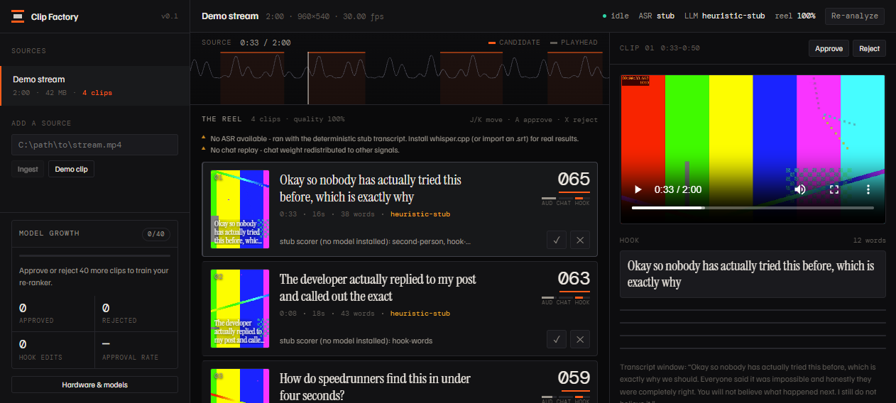
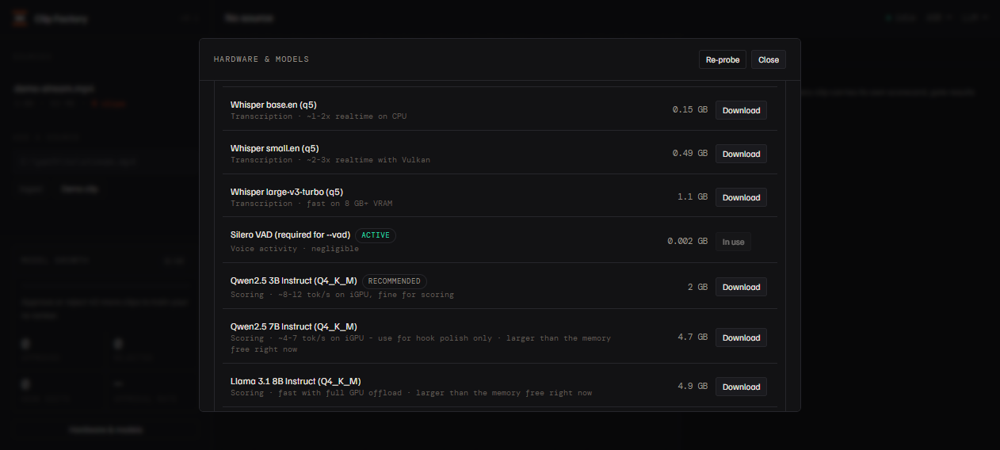
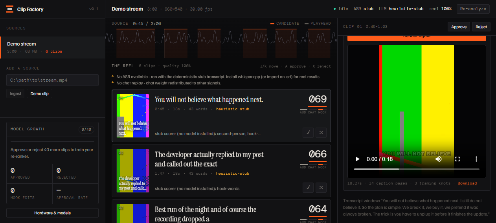
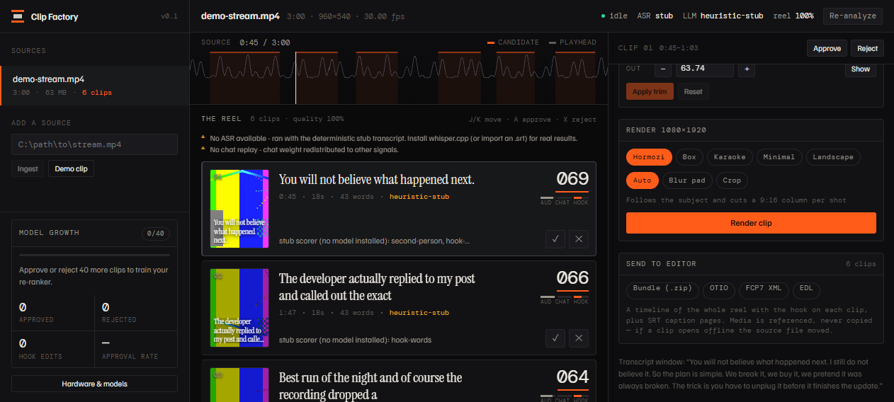

# Clip Factory

Local-first stream clipper. Point it at a long VOD; it finds the moments worth
posting and hands you a reviewable reel with a quality scorecard on every clip.
Nothing is uploaded, and the only model is the one you install.

Built for laptops that are not fast: the deterministic signals do the finding,
the LLM only re-ranks a short list, and the whole analysis pipeline runs in
~65 MB of resident memory for a 2-minute source (see [Measured cost](#measured-cost)).



---

## What actually works right now

| Area | State |
|---|---|
| Ingest (local file), ffprobe, streamed audio, peak pyramid | working |
| Transcription: whisper.cpp adapter + SRT/VTT import + deterministic stub | working |
| Word alignment (monotonic clamp, silence snapping, outlier repair) | working |
| Signals, percentile fusion, sentence-aligned windows | working |
| Quality gates + visible scorecard + reel quality score | working |
| LLM re-ranking with GBNF-constrained JSON, plus a labelled stub scorer | working |
| Diversity/overlap/dedupe selection | working |
| Caption page grouping with CPS + line-budget warnings | working |
| Scene-cut detection, window snapping, shot boundaries | working |
| Auto reframe: subject-following 9:16 crop with a per-shot camera path | working |
| Trim in/out with transcript, captions and gates kept in sync | working |
| Feedback loop: decision log → personal re-ranker → few-shot memory → style profile | working |
| Hardware probe + tier advisory + model recommendations | working |
| Model manager: resumable downloads in-app, activation that survives restart | working |
| Desktop shell (Electron + Python sidecar, orphan-proof) | working |
| ASS/libass caption burn + vertical 1080x1920 render via ffmpeg | working |
| Hardware encoder probing (AMF/NVENC used only when a test encode passes) | working |
| Editor handoff: OTIO, FCP7 XML, CMX 3600 EDL, SRT, zip bundle | working |
| Gold-set benchmark in CI, `filmcraft-cli` command schema | **not yet built** |

The reel now leaves the app: one zip carries an OTIO timeline, an FCP7 XML, an
EDL, per-clip SRT captions and a manifest, all with timecodes from the same
functions. What is *not* built is driving `filmcraft-cli` directly, because that
alpha project has not published its command schema — inventing one would be a
handoff that fails on the user's machine. OTIO is its documented import path, so
that is the path this uses.

---

## How a clip actually gets made

Every clipper advertises "AI finds your best moments". Here is what that has to
mean mechanically, and what this build does at each step.

**1. Look for cheap evidence first.** Loudness, spectral flux, speech density,
and a hook lexicon cost nothing and are right often enough to cut 99% of the
timeline. A 3B model reading 6,000 words to find five clips is how you get
confident, well-formatted, mediocre picks.

**2. Cut on sentences, not a grid.** Windows are built from utterance
boundaries, so "starts and ends mid-sentence" is impossible by construction
rather than filtered out afterwards. A 30 s target with 15–90 s clamps covers
the shape of a short.

**3. Move the edges onto real edits.** A clip that opens two frames before a
scene change reads as a mistake. Cuts are detected (**keyframes only** — a
streaming VOD has a 2 s GOP, so this is thousands of decodes instead of
hundreds of thousands) and edges within 0.75 s are snapped onto them. The
transcript is then rebuilt from the utterances the new span covers, which is what
keeps captions and gates from silently disagreeing with the timecode.

**4. Reject before spending tokens.** Gates run on every window first: ASR
confidence, speech coverage, hallucination shapes, sponsor reads, stream warm-up,
minimum words, banned topics — then structure: duration, a hook cue in the first
three seconds, self-containment, a terminal sentence at the end.

**5. Let the model judge a shortlist.** A deduplicated, time-spread shortlist of
~12–40 windows goes to the LLM, batched, with a GBNF grammar so the JSON cannot
be malformed. It returns `{score, hook, title, reason}` and the score is blended
with the signal score rather than replacing it.

**6. Pick like an editor.** Greedy by score, rejecting >20% overlap and near
duplicates by embedding cosine, then re-ordered so the reel is not four clips
from the same ten minutes.

**7. Frame the subject.** See [Rendering](#rendering) — one crop decision per
shot, panned, not a per-frame face follow.

**8. Measure it.** Every clip carries a visible scorecard and the reel carries a
quality score, so "is this better?" is a number and not a vibe.

### What the vendors say, and what this does

| Claim | This build |
|---|---|
| "A virality score from 0–100" (Klap) | A blended score plus a reason; explicitly **a ranking signal, not a forecast** |
| "Reads the transcript and picks moments that work alone" | Same, with a grounding check that the hook is entailed by the transcript |
| "Chapters first, then clips" (OpusClip) | Chapter spans exist for spreading picks; selection is still window-level |
| "Auto Reframe tracks the active speaker" | Tracked by column motion + skin density, not a face model — cheaper, and honest about what it measures |
| "Vendors do not publish their rubric" | The scorecard here is eight named checks you can read on screen |

---

## Quickstart

```bash
# 1. Python sidecar
py -3 -m venv .venv
./.venv/Scripts/python.exe -m pip install -r requirements.txt

# 2. Web UI
cd web && npm install && cd ..

# 3. Run both (two terminals)
./.venv/Scripts/python.exe -m clipper --port 8756          # needs PYTHONPATH=backend
cd web && npm run dev                                       # http://localhost:5173
```

`PYTHONPATH=backend` matters: without it `python -m clipper` cannot find the
package. `scripts/run.cmd` does all of this for you.

Or use the desktop shell (builds the UI first):

```bash
cd web && npm run build
cd ../desktop && npm install && npx electron .
```

If Electron refuses to start with `app is undefined`, your shell has
`ELECTRON_RUN_AS_NODE=1` set; unset it for that command.

Then in the UI: **Generate a demo stream → Analyze**, or paste a path to a real
VOD. With no model installed the app runs the deterministic stub scorer and says
so on every clip.

### Getting a model

Open **Hardware & models → Models**. Every curated model is listed with its size,
whether it fits the memory free *right now*, and whether it is already in use.
Download is in-app, resumable, and leaves a SHA-256 beside the file so a truncated
download is caught on the next run instead of at inference time.



Transcription also needs a `whisper.cpp` binary, which is not shipped: drop
`whisper-cli.exe` into `<data>in` or put it on `PATH`. The dialog tells you when
that binary is missing rather than silently falling back to the stub — a model
with no binary used to look exactly like "transcription is broken".

### Tests

```bash
./.venv/Scripts/python.exe -m pytest        # 148 tests, ~18 s, includes real encodes
./.venv/Scripts/python.exe scripts/perf.py  # per-stage time and peak memory
```

---

## How it avoids garbage output

Five gates, all deterministic except the self-critique:

1. **Input gates** — ASR confidence, low-confidence ratio, speech coverage,
   non-Latin ratio (catches the whisper music/silence hallucination class),
   sponsor reads, stream warm-up, blocklist.
2. **Structural gates** — sentence-bounded edges, a hook cue inside the first
   three seconds, non-deictic opening ("this…", "and then…" fail), length band.
3. **Selection constraints** — overlap rejection, lexical near-duplicate
   rejection, and a cap per 30-minute region so the reel is not ten variations
   of one hot streak.
4. **Grounding check** — the hook must be supported by the clip's own transcript;
   numbers in the hook must appear in the clip.
5. **Visible scorecard** — eight pass/fail items per clip and an aggregate reel
   quality percentage. The UI shows the same numbers the tests assert on.

Windows that fail a block gate never reach the LLM at all. That is the whole
point: the model is a re-ranker, not the detector.

---

## How the AI gets better

Fine-tuning a 7B model on a few hundred examples overfits; few-shot prompting
usually wins. So the learning loop is retrieval plus a tiny model, and
fine-tuning is an export path, not a mechanism.

1. **Decision log** — every approve/reject (with a one-word reason), hook edit
   and trim is stored with the exact feature vector at decision time. Immutable.
2. **Personal re-ranker** — logistic regression over those features, trained in
   milliseconds on the CPU, blended into the pipeline score. It activates at 40
   decisions and **only replaces the live model if it beats both the pipeline
   score and the previous ranker on a time-based holdout** (AUC, +0.02 margin).
   That gate is what stops the loop from degrading into garbage.
3. **Few-shot memory** — the three most similar windows you approved and the
   three you rejected are injected into the scoring prompt. Zero training.
4. **Style profile** — deterministic statistics from your hook edits ("shortens
   hooks by 3 words, removes emoji"), injected as a stable prompt prefix so the
   KV cache is reused.
5. **Export** — `GET /api/learn/export` emits SFT pairs + DPO triples for people
   who want to fine-tune elsewhere.

Everything is per-machine, versioned, inspectable and revertible. Feedback can
only re-rank inside the gated pool — it can never manufacture a clip that fails
the gates.

---

## Rendering

The clip is finished in one `ffmpeg` pass: source trimmed, reframed to
1080×1920, captions burned by libass, audio normalised to -14 LUFS.

| Preset | Look |
|---|---|
| `hormozi` | heavy Arial Black, one line at a time, orange on black outline |
| `box` | solid plate behind each line, high contrast for noisy footage |
| `karaoke` | white text, orange word-by-word fill using ASS `\k` tags |
| `minimal` | light weight, low position, no outline |
| `landscape` | 16:9 passthrough for non-vertical platforms |

Pages are grouped to a reading-speed limit (19 cps), a two-line budget and a
minimum on-screen time: a page that would flash for one frame is merged into its
neighbour or given silence to sit in, never shown for 0.2 s and left there. The
editor shows every page's words and every warning, which is what
`docs/ui-captions.png` is (a caption page is not a sentence and the UI does not
pretend otherwise).

Framing has three modes:

| Mode | What it does |
|---|---|
| `auto` | Cuts a 9:16 column out of the source and **moves it per shot** to follow the subject |
| `blur` | Blurred, darkened source as the backdrop with the full picture fitted on top |
| `crop` | Centre crop, no tracking |

### How auto framing decides where to look

No face model is bundled, so the subject is located with two signals measured on
a 96×54 grid: **frame-to-frame motion per column** (faces, hands, gameplay
action) and **skin-tone density per column** (keeps a talking head centred while
it is still). Scores are normalised across the whole clip, so a quiet shot and a
loud shot are comparable instead of each renormalising to fill the range.

The output is a **virtual camera**: one crop centre per shot, panned linearly
between shots, emitted as a piecewise-linear expression that ffmpeg evaluates per
frame:

```
crop=304:ih:x='if(lt(t,14.520),148+(30)*(t-0.000)/14.520,178)':y=0,scale=1080:1920
```

Three deliberate choices, all of which came out of reading how the commercial
tools describe their reframers:

* **Per shot, not per frame.** Following the subject every frame reads as a
  handheld camera and wobbles on every gesture. A locked position for the whole
  clip ignores a cut to a different subject. Editors make one framing decision
  per shot; so does this.
* **The planner and the renderer share one geometry function** (`CropPlan.at`),
  so the crop that was measured is the crop that is displayed. Drift between
  those two is how "smart" reframing silently ships black bars.
* **A plan you can inspect.** `GET /api/sources/{id}/clips/{id}/framing`
  returns the cuts, the shots and the knots, because a reframe you cannot see is
  indistinguishable from a bug the first time it is wrong.

If sampling fails, the render falls back to a centre crop and says `crop` in the
filename rather than pretending it tracked anything.

Hardware encoders are **probed, not trusted**: each candidate runs a one-frame
test encode at startup and is used only if it actually succeeds. This machine has
`h264_nvenc` compiled into ffmpeg but no NVIDIA driver, so the probe correctly
falls through to `libx264`. Rendering a 16 s clip takes ~7 s here.



Better to fail loudly than ship a file with no captions: ffmpeg's stderr is
captured and surfaced in the UI, and a relative data directory is resolved to an
absolute path before the renderer `chdir`s into its work folder.

---

## Handing off to an editor

Rendering is the end of the line for a clip nobody wants to change. For a clip
somebody will want to change, the handoff is a bundle:

| File | For |
|---|---|
| `reel.otio` | OpenTimelineIO — Resolve, Premiere (adapter), FilmCraft |
| `reel.xml` | FCP7 XML — native import in Premiere and Resolve |
| `reel.edl` | CMX 3600 — the fallback that cannot go offline |
| `captions/*.srt` | the pages, so burned-in text stays editable |
| `manifest.json` | in/out, frames, timecode, hook, score, framing knots |
| `render/*.mp4` | any clips already rendered, included when present |

Four formats because no single one is accepted everywhere, and one `ClipSpec`
behind all four. Media is **referenced by absolute path, never copied**: a
two-hour VOD inside a zip is a mail attachment nobody can send.



The part that matters is the test called `test_every_format_agrees_on_the_timeline`.
Three backends derive the same clip's timing independently — ffmpeg's ASS events,
the SRT cues, and OTIO's source range — and the test asserts they land on the
same seconds. Without it, a handoff can retime captions by eight frames and
nobody notices until the clip is posted.

Drop-frame timecode is deliberately not implemented: it only differs from
non-drop on 29.97/59.94 material past ~10 minutes, and these clips are 15–90 s.
The limitation is written in the module rather than papered over.

---

## Efficiency

The design rule is `peak = max(ASR, LLM)` and never `ASR + LLM`. One job worker
runs one heavy stage at a time. Audio is streamed in 60 s blocks, frames never
enter Python, the waveform is pre-rendered peaks, and the LLM budget goes to a
pre-deduplicated shortlist rather than every window.

### Measured cost

`scripts/perf.py`, 2-minute source, stub ASR, this machine:

| Stage | Seconds | Peak MB |
|---|---|---|
| baseline (imported, idle) | — | 55 |
| audio | 0.93 | 64 |
| transcribe + align + windows | 0.05 | 59 |
| signals + gates | 0.06 | 58 |
| score (stub) | 0.03 | 58 |
| select | 0.03 | 59 |
| **total** | **1.06** | **64** |

Real ASR adds a separate `whisper-cli` process (roughly +0.5 GB for
`small.en`, +1.5 GB for `medium.en`); a 3B scorer adds ~2.0 GB in
`llama-server`. Those are separate processes precisely so the OS can reclaim
them the moment a stage ends.

Frontend: 78 KB gzipped JS, 4.5 KB CSS, no animation library, no utility
framework, no audio decoding in the renderer.

---

## Architecture

```
web/                      React + TS, hand-authored CSS (no Tailwind)
  src/components/         Sidebar, Waveform, ClipCard, Inspector, SetupModal
desktop/                  Electron shell: spawns + health-checks + tree-kills the sidecar
backend/clipper/
  api.py                  FastAPI; also serves web/dist in production
  service.py              the pipeline as one resumable function
  pipeline/
    media.py              ffprobe, streamed audio, RMS/flux/ZCR, peak pyramid
    asr.py                whisper.cpp (-oj -ml 1 --vad -fa), SRT/VTT import, stub
    align.py              monotonic clamp, silence snapping, outlier repair
    signals.py            five signals, percentile normalisation, fusion
    windows.py            sentence-aligned candidate windows, scene snapping
    scenes.py             keyframe scene cuts, chapters, shot spans
    framing.py            96x54 activity grid -> per-shot virtual camera path
    gates.py              G1 input gates, G2 structural gates
    scorecard.py          grounding check + visible scorecard
    select.py             overlap / duplicate / diversity selection
    caption/group.py      caption pages, CPS limits, line budgets
  render/                 ASS captions + ffmpeg argument construction
  editors/                handoff to an NLE, one ClipSpec behind four formats
    timecode.py           frame maths - the only place time is converted
    spec.py               ClipSpec: the clip as every backend sees it
    otio.py               OpenTimelineIO timeline
    xmeml.py              FCP7 XML sequence
    edl.py                CMX 3600 edit decision list
    srt.py                caption sidecars
    bundle.py             manifest + zip of all of the above
  llm/                    GBNF grammar, prompts, llama-server + stub scorers
  learn/                  decision log, re-ranker, few-shot memory, style profile
  hw/                     (hardware.py) probe, tier advisory, model manifest
  rt/                     peak-RSS sampling used by scripts/perf.py
scripts/perf.py           measured resource report
```

The sidecar binds `127.0.0.1` only. There is no account layer, no telemetry and
no cloud path; the only network calls are the optional model download and URL
imports, both opt-in.

---

## Where this goes next

1. **Chat signal** — parser exists (`load_chat_rate`); needs a fetch step for
   Twitch VODs so the chat weight stops being redistributed away.
2. **Gold-set benchmark** — hand-labelled moments per fixture video, scored in
   CI so a change that makes picks worse fails the build. The scorecard measures
   the clip; nothing yet measures the *picks* against a human ranking.
3. **`filmcraft-cli` command batches** — blocked on the alpha project publishing
   its command schema. OTIO import ("File → Import Timeline") works today, so
   this is a convenience, not a capability.
4. **Speaker-aware framing** — the reframer tracks motion and skin, so on a
   two-person podcast it follows activity rather than the person talking. A YuNet
   ONNX pass plus mouth-activity scoring is the documented upgrade, and
   `CropPlan` is already the interface it would plug into.
