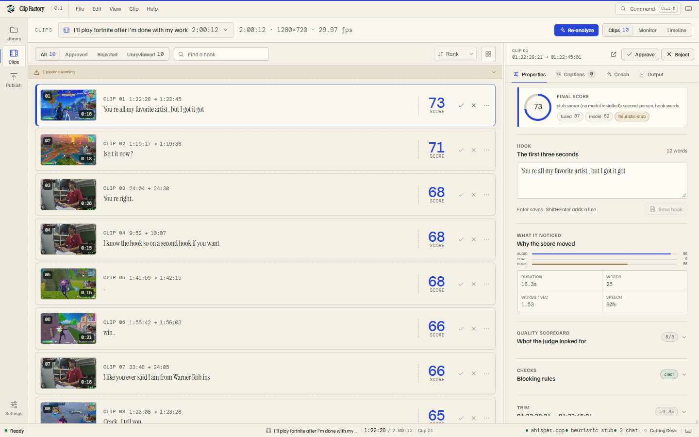

# Clip Factory

Clip Factory is a local-first cutting room for turning long videos into vertical, captioned shorts.

It ingests a VOD, finds sentence-bounded moments, rejects the obvious failures, asks a model to judge a shortlist, and puts the result in an editor. You review the evidence, adjust the hook and trim, then render a 1080 × 1920 master or hand the whole reel to another editor as a timeline.

## The two ideas behind it

**Find with cheap evidence, judge with a model.** Loudness, speech density, scene cuts, chat rate and a hook lexicon decide where to look. Rules reject clips that cannot stand alone. Only the surviving shortlist goes to the language model. The model is a re-ranker, not the detector.

**Show the decision.** Every clip carries the same evidence the pipeline used: signals, a visible scorecard, gate results, the judge's reason, caption pages and trim points. A number you cannot inspect is not useful.

## Start here

| Page | What it covers |
|---|---|
| [Getting Started](Getting-Started.md) | Install, run, and cut a first clip |
| [The Workspace](The-Workspace.md) | Areas, rail, tabs, inspector, shortcuts and themes |
| [Reviewing Clips](Reviewing-Clips.md) | Read the reel, approve or reject, edit hooks and trims |
| [Rendering and Export](Rendering-and-Export.md) | Captions, framing, MP4 output and NLE handoff |
| [Publishing](Publishing.md) | Upload to YouTube or X with your own developer app |
| [Learning from your posts](Learning.md) | Connected accounts, engagement labels, the weekly model and coach |
| [Themes](Themes.md) | The theme atelier, built-in themes and authoring |
| [Architecture](Architecture.md) | How the frontend, API and pipeline fit together |
| [API Reference](API-Reference.md) | HTTP endpoints, jobs and data shapes |
| [Development](Development.md) | Tests, builds and where to change things |
| [Troubleshooting](Troubleshooting.md) | Common failures and what to check |
| [Limitations](Limitations.md) | Deliberate boundaries and current gaps |

## One clip, end to end

1. **Add a source.** Add a local file, paste a Twitch or YouTube VOD URL, or generate the demo stream.
2. **Analyze.** The pipeline transcribes, builds candidate windows, runs gates, scores and selects.
3. **Read the reel.** Clips are ranked, searchable and filterable. Each one shows its score and hook.
4. **Review.** Approve, reject with a reason, rewrite the hook, nudge the trim.
5. **Check the monitor.** Captions, 9:16 guides, loop and frame stepping sit in one transport.
6. **Render.** Pick a caption preset and framing mode. The MP4 is written locally.
7. **Hand off.** Bake finished MP4s, or export a bundle with OTIO, FCP7 XML, FCP X XML and SRT/VTT captions.
8. **Publish, then learn.** Queue the render to YouTube or X from the Output tab, then let **Publish → Accounts** sync how it did.

## What is in the box

| Area | Current capability |
|---|---|
| Sources | Local video, HTTP(S) VODs through `yt-dlp`, demo stream, SRT/VTT through the API, optional Twitch chat replay |
| Analysis | whisper.cpp or imported subtitles, sentence-bounded windows, scene-cut snapping, deterministic gates, optional LLM shortlist scoring |
| Review | Ranked reel, filters, search, grid/list views, scorecard, signals, gates, hook editing, trim controls |
| Monitor | Source preview, caption overlay, hook overlay, 9:16 guides, loop, frame and second stepping |
| Finish | Five caption presets, three framing strategies, optional face tracking, libass burn-in, -14 LUFS mix, 1080 × 1920 MP4 |
| Handoff | Zip bundle, OTIO, FCP7 XML, FCP X XML, EDL, SRT/VTT; bake to MP4s; media referenced by absolute path |
| Publish | Direct YouTube or X upload from a rendered MP4, durable retry queue, bring-your-own OAuth client |
| Learning | Local decision log and taste re-ranker, connected-account engagement analytics, gated weekly personal model, evidence-based coach suggestions |
| Interface | Library / Clips / Publish areas, one header per area, resizable floating inspector, command palette, context menus, six built-in themes |

## Local by default

Clip Factory binds the API to `127.0.0.1`, stores its database and artifacts in a local data directory, and has no account system, telemetry or cloud dependency. The page requests its default UI typefaces from Google Fonts; offline, it falls back to system fonts. Other network access happens when you import a URL, fetch Twitch chat, download a model, or apply a custom theme that declares a remote font stylesheet.

The desktop shell and the browser UI both talk to the same local API. The backend is a sidecar, not a hosted service.

## A note on the score

The score is a ranking signal inside this pipeline, not a forecast of views. It combines cheap signals with a model judgement and is gated by structural checks. Use it to order your review, then use your judgement.

---

Clip Factory is a working application and a set of documented trade-offs. Where a capability is deliberately absent, the [Limitations](Limitations.md) page says so rather than implying it exists.
