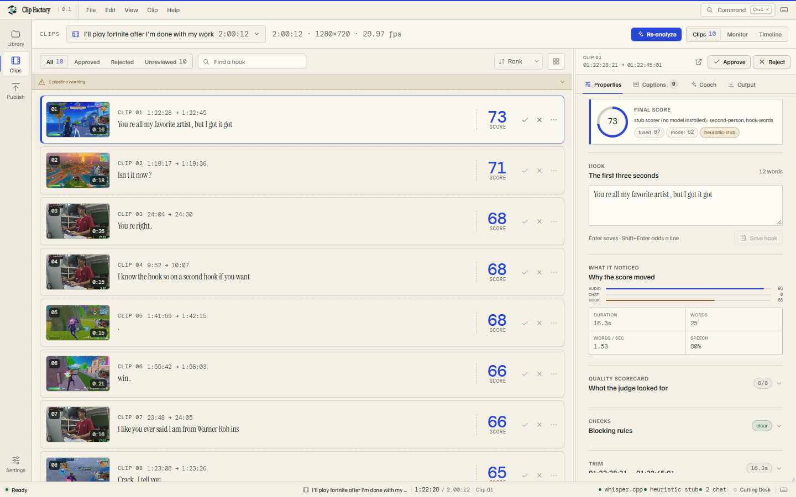
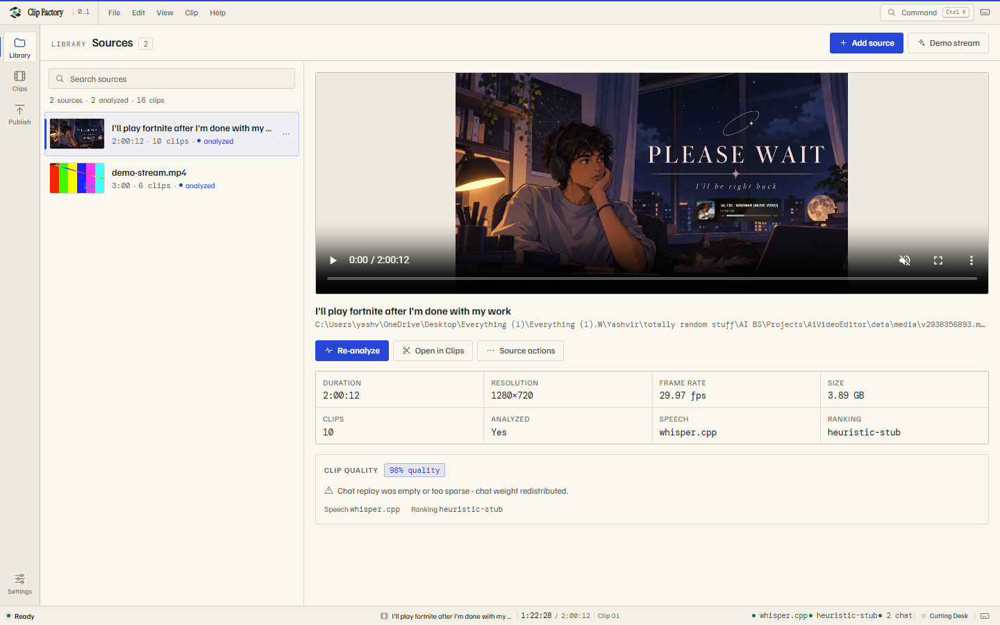

# The Workspace

Clip Factory is organised as three **areas** rather than one stage surrounded by
permanent panels: **Library** (sources and ingest), **Clips** (the reel, monitor,
timeline and inspector) and **Publish** (uploads, accounts, performance). A
narrow rail on the left switches areas; each area owns one header and only the
panes that belong to it. Nothing is permanently squeezed into a corner.

## The shell

### Menu bar

**File**, **Edit**, **View**, **Clip** and **Help** contain the main commands.
Commands that need a selection disable themselves instead of failing after a
click. **View** also jumps between areas (`Ctrl 1` / `Ctrl 2` / `Ctrl 3`) and
between the Clips tabs (`1` / `2` / `3`). **Help → Take the tour** replays the
first-run walkthrough from anywhere.

The right side of the bar has the **Command** button and the keyboard-shortcut
button. The command palette is the fastest way to find a command you have not
memorised.

### Rail

| Area | What it holds | Shortcut |
|---|---|---|
| **Library** | Source list, ingest form, source player, facts and analysis quality | `Ctrl+1` |
| **Clips** | The reel, the monitor and timeline, and the clip inspector | `Ctrl+2` |
| **Publish** | Upload queue, connected accounts, performance and learning | `Ctrl+3` |

The **Publish** icon carries a badge while uploads are queued or running. The
gear at the bottom of the rail opens **This computer**, **Theme studio**,
**Keyboard shortcuts** and **About**.

### Headers

Every area has one 52 px header. It always carries the area name, the current
subject, and the actions for that subject — for Clips that is the source picker,
the source format, **Re-analyze** and the **Clips / Monitor / Timeline** switch.
Secondary controls live on a second row inside the list (filters, search, sort),
not in a third strip across the app.

## Library

- **Sources** lists every imported source with duration, size, analyzed state and
  clip count. Select one to load its analysis. The search field narrows the list.
- **Add source** accepts a local path or an HTTP(S) VOD URL. **Demo stream**
  generates a self-contained test source.
- The detail pane shows the player, the file facts, the speech and ranking
  backends, and the pipeline quality. **Re-analyze** re-runs analysis;
  **Open in Clips** switches area with the source selected.
- **Source actions** holds rename, reveal and remove for the selected source.

## Clips

The header names the source and its format. The list below it is the ranked
reel: filter chips (All, Approved, Rejected, Unreviewed), search, sort, and the
list/grid switch. Each card shows the hook, the timecode, the score and quick
approve/reject controls.

The **Clips / Monitor / Timeline** switch in the header changes the centre pane,
not the whole screen:

| Tab | Purpose |
|---|---|
| **Clips** | The ranked reel: filters, search, list/grid views, approve and reject |
| **Monitor** | Source preview, hook and caption overlays, 9:16 guides, transport and clip actions |
| **Timeline** | The source audio envelope, ranked clip markers and playhead; click to select, double-click for the monitor |

Switch with `1`, `2`, `3`, or by clicking a tab. The tab counts update as clips
are reviewed.

### Inspector

The right panel is always about the current clip. It has four tabs:

| Tab | Contents |
|---|---|
| **Properties** | Final score, hook editor, signal bars, clip facts, quality scorecard, gates, trim, transcript window |
| **Captions** | Caption pages with timings, characters per second, line layout and warnings |
| **Coach** | Evidence-backed suggestions, each with preview, apply and undo |
| **Output** | Caption preset, framing, render action, rendered preview, handoff formats |

Collapse it with `Ctrl+B`; the **View** menu can float it instead. Below 1240 px
the inspector becomes a drawer over the stage so the reel keeps its width;
`Esc` closes it.

## Publish

The **Queue** tab lists upload jobs with state, attempts, age and retry; it
refreshes itself while a job is in flight. **Accounts** connects YouTube and X
and shows measured posts. **Performance** holds the re-ranker's growth,
warnings, clip quality and the local learning dataset. See
[Publishing](Publishing.md) and [Learning from your posts](Learning.md).

## Status bar

The bottom rail reports the current activity and progress, the selected source
and clip, the active engines, the theme swatch (also the entry to the theme
atelier) and the inspector toggle.

## Panels that behave like panels

- Drag the splitter beside the inspector to resize it; the width persists.
- Collapse the inspector without losing its tab.
- **View → Float inspector** detaches it into a movable window. Drag its bar,
  resize from the lower-right corner, double-click the bar or use the dock
  button to return it.
- **Edit → Reset layout** restores the default area, widths and tabs.
- Area, tab choice, filters, sort order, view mode, inspector tab and monitor
  settings are saved to `localStorage` under `clip-factory.workspace.v2`.
- Themes have their own store under `clip-factory.theme.v1`.

At narrow widths the shell compacts around the stage. Areas stay one click away
in the rail, and the inspector can float over the stage rather than squeezing it.

## Commands and menus

Every menu command is also a palette command. **Ctrl/Cmd+K** opens the palette;
type a few letters and press Enter. Results are grouped by File, Edit, Go, View,
Clip and Help.

Right-click a clip card for its context menu: select, open on the monitor,
approve, reject, render, copy the hook or copy the timecode. The same commands
appear in the **Clip** menu.

## Keyboard shortcuts

Shortcuts are ignored while you are typing in a hook, trim or search field.

### Workspace

| Action | Keys |
|---|---|
| Command palette | `Ctrl/Cmd+K` |
| Library / Clips / Publish | `Ctrl 1` / `Ctrl 2` / `Ctrl 3` |
| Toggle inspector | `Ctrl/Cmd+B` |
| Clips / Monitor / Timeline | `1` / `2` / `3` |
| Shortcut reference | `?` |

### Review

| Action | Keys |
|---|---|
| Next / previous clip | `J` / `K` |
| Approve selected clip | `A` |
| Reject selected clip | `X` |
| Render selected clip | `R` |
| Dismiss the rejection bar / drawer | `Esc` |

### Monitor

| Action | Keys |
|---|---|
| Play / pause | `Space` |
| Step one second | `←` / `→` |
| Step five seconds | `Shift+←` / `Shift+→` |
| Step one frame | `,` / `.` |
| Loop selected clip | `L` |

## Themes

Open the theme atelier from the swatch in the status bar, the rail's Settings
menu, or **View → Theme studio**. The Marketplace applies a theme immediately;
the Studio edits one with a live preview. Built-in themes cover light, dark and
neutral rooms, and custom themes are stored locally.

See [Themes](Themes.md) for the interface and the theme file format.

## What is intentionally not here

There is no track stack, keyframe editor, effects panel or timeline trimming
surface. The timeline is for reading the selected clip, not for building a
multi-track sequence. Finishing belongs in the render flow or in the editor you
hand the project to.

---

Next: [Reviewing Clips](Reviewing-Clips.md).
