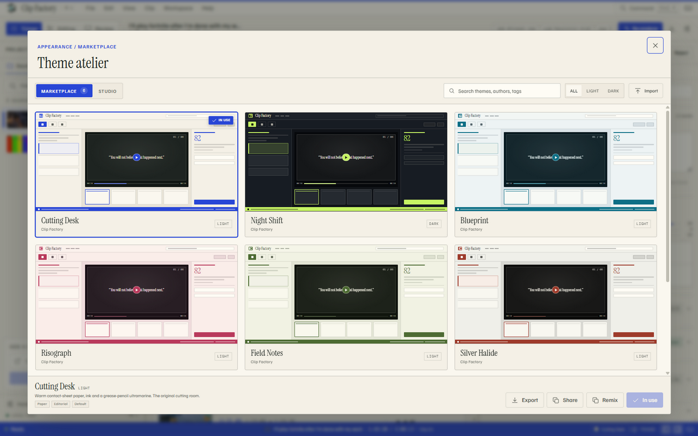

# Themes

Clip Factory is themed from nine colours. Everything else — hairlines, muted text, button states, the monitor surround, the timeline canvas — is derived from those seeds. The result is a room you can change without editing CSS.



Open the atelier from the round swatch at the right of the status bar, or from **View → Theme atelier**.

## Marketplace and Studio

The atelier has two views.

**Marketplace** is your local library: six built-in themes plus any themes you have made or imported. Search by name, author, description or tag; filter to light or dark. Selecting a card shows its description and actions. Double-click a card, or choose **Use theme**, to apply it.

A card marked **In use** is already applied. **Export** downloads the theme as JSON; **Share** copies the same JSON to the clipboard and falls back to a download when the clipboard is blocked. **Remix** opens a built-in theme as a new custom theme; **Edit** opens one of yours.

**Studio** is the editor. It keeps a local draft until you have made a change or chosen **Use this theme**. Opening Studio does not create a theme; the first edit saves the draft in this browser. Changes to the currently applied theme are visible immediately.

## The six built-in themes

| Theme | Scheme | Character |
|---|---|---|
| **Cutting Desk** | Light | Warm contact-sheet paper, ink and ultramarine. The default. |
| **Night Shift** | Dark | Graphite, warm white and phosphor lime for late edits. |
| **Blueprint** | Light | Cool drafting paper and petrol ink; precise and architectural. |
| **Risograph** | Light | Blush stock, blackberry ink and a riso-pink marker. |
| **Field Notes** | Light | Sage paper, olive ink and a notebook grid. |
| **Silver Halide** | Light | Neutral darkroom greys with a safelight red. |

All six share the same type system: Familjen Grotesk for interface text, DM Mono for data, Instrument Serif for display. The monitor stays dark and neutral regardless of the surrounding theme so the footage is judged against a consistent stage.

## Making a theme

1. Open the atelier and choose **Make a theme**, or **Remix** a built-in.
2. Name it and set an author and one-line description.
3. Change the nine seeds. Use the colour picker or type a hex value; invalid text reverts on blur.
4. Optionally open **Typography & corners** to change the UI, display and mono font stacks, add an HTTPS font stylesheet, and set a corner radius from 0 to 12 px.
5. Check the **Readability** panel. It reports WCAG contrast for ink on canvas, ink on surface, monitor labels and accent labels. A low ratio is a warning, not a block.
6. Choose **Use this theme**. If the draft was never saved, this saves and applies it.
7. **Export** to download a `.clip-theme.json`, or **Share** to copy the package.

Custom themes save automatically after the first edit and live in this browser. They are available in the Marketplace immediately.

### The nine seeds

| Seed | Governs |
|---|---|
| `canvas` | The room behind the panels |
| `surface` | Cards, panels and raised fields |
| `ink` | Primary text and marks |
| `accent` | Focus, selection, active tools and the score |
| `stage` | The monitor surround and dark inset areas |
| `stageInk` | Text and marks placed on the stage |
| `ok` | Success and approval |
| `warn` | Warnings and low-confidence states |
| `danger` | Destructive actions and rejection |

Derived tokens include muted text, hairline and strong lines, accent tints, status surfaces, scorecard colours, shadows and code blocks. The derivation lives in `web/src/theme/compile.ts`.

### Scheme and tags

Theme files also carry `scheme` (`light` or `dark`) and optional `tags`. Scheme sets the browser's native colour scheme and informs the marketplace filter. The Studio preserves the base scheme and tags but does not expose controls for them; set them in the JSON if you are authoring by hand.

Tags are used only for search. They are not a classification system the app enforces.

## Importing and sharing

**Import** accepts a `.json` theme file. Both a bare theme object and the packaged envelope are accepted.

```json
{
  "format": "clip-factory.theme",
  "version": 1,
  "theme": {
    "id": "custom-my-room",
    "name": "My Room",
    "author": "You",
    "description": "A quiet room for cutting.",
    "scheme": "light",
    "tags": ["Custom"],
    "seeds": {
      "canvas": "#edf0e9",
      "surface": "#f8faf3",
      "ink": "#18211c",
      "accent": "#206f63",
      "stage": "#0b1411",
      "stageInk": "#eef4eb",
      "ok": "#2c7151",
      "warn": "#8a6418",
      "danger": "#b13b3b"
    },
    "fonts": {
      "ui": "'Familjen Grotesk', system-ui, sans-serif",
      "display": "'Instrument Serif', Georgia, serif",
      "mono": "'DM Mono', ui-monospace, monospace"
    },
    "radius": 3
  }
}
```

The importer requires all nine seeds, discards unknown fields, and silently ignores a font stylesheet that is not HTTPS. An imported theme gets a unique custom id, is saved locally, and is applied immediately. The toast confirms it was added to your library.

The full schema, seed guidance and a downloadable starter live in [Theme authoring](../theme-authoring.md). A valid starter package is also served at `/themes/starter.json`.

## Where themes live

Theme settings are stored under `clip-factory.theme.v1` in `localStorage`: the selected id and an array of custom themes. There is no theme server and no account. Clearing site data removes custom themes; export anything you want to keep.

Removing the active theme returns you to Cutting Desk. Removing an inactive theme leaves the current room unchanged. Both actions ask for confirmation inside the Studio.

## Accessibility

- Contrast ratios are shown while editing rather than discovered after applying.
- Every theme derives focus and selected states from the accent seed, but a low-contrast accent will produce low-contrast focus. Check the accent ratios before shipping a theme.
- The interface is keyboard operable; the atelier's controls are native buttons, inputs and colour pickers.
- The dark monitor is intentional. It is not a theme failure when a light theme still has a dark video stage.

## Note on the word marketplace

The Marketplace is a local library, not a hosted store. It ships with six themes and shows the themes on this machine. Sharing happens through JSON, by download or clipboard; there is no browse-and-install catalogue on the network.

---

Next: [Architecture](Architecture.md).
